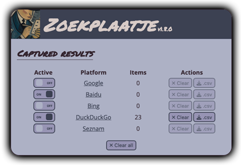

# 🕵️ Zoekplaatje

Zoekplaatje is a browser extension that monitors search results as you see them in your browser and allows you to later
download them as a .CSV spreadsheet. It is intended to facilitate systematic analysis of search results, e.g. for 
(algorithmic) bias.

Currently, it supports the following search engines:
* [Baidu](https://baidu.com)
* [Bing](https://www.bing.com)
* [Daum](https://www.daum.net) (integrated search, desktop)
* [DuckDuckGo](https://duckduckgo.com) (organic results only)
* [Google](https://www.google.com)
* [Najdi.si](https://najdi.si)
* [Naver](https://www.naver.com) (integrated search, desktop)
* [Seznam](https://seznam.cz)
* [Yandex](https://yandex.com)

Engine support requires regular maintenance to keep up with changes to the engines. If something does not work, we
welcome issues and pull requests.

The extension does not interfere with your normal browsing and never uploads data. It uses the 
[WebRequest](https://developer.mozilla.org/en-US/docs/Mozilla/Add-ons/WebExtensions/API/webRequest) browser API to 
locally collect and parse the data search engines are sending to your browser as you use it. 

## Installation
Zoekplaatje is in active development. .xpi files that you can use to install it in your browser are available on the 
[releases](https://github.com/digitalmethodsinitiative/zoekplaatje/releases) page. These are signed and can be installed 
in any Firefox-based browser. If you want to run the latest development version instead, you can [do so from the Firefox
debugging console](https://www.youtube.com/watch?v=J7el77F1ckg) after cloning the repository locally.

## How to use
Install the browser extension in a Firefox browser. A button with the Zoekplaatje logo (a silhouette) will appear in the 
browser toolbar. Click it to open the Zoekplaatje interface. Enable capturing for the search engines you want to 
capture from.

Next, simply search for things as you normally would. While Zoekplaatje is enabled, results will be saved in the 
background. You can then download the results as a .csv file with the button in the interface when you are done and
want to inspect the results. Make sure to cross-reference the results with what you see in your browser, at least 
initially, to understand what data is (and is not!) collected and how it is parsed.

The .csv file uses UTF-8. The `timestamp` column gives the time of capture in UTC, as `YYYY-MM-DD HH:MM:SS`. Values 
are written as they were captured, so a spreadsheet program may run a value that starts with `=` as a formula.

The `pages` button downloads a second .csv file with one row for each page view on which results were captured. The 
`page_id` column connects it to the results file. Each page has its URL, query, results page, the time of the first and 
last capture, the number of rows, and run details: the version of Zoekplaatje, the browser, the languages that Firefox 
asked for (`accept_language`), the time zone and the size of the window and the page. In the Settings tab you can also 
save the privacy settings of Firefox, the country of your internet connection (found with Cloudflare), the IP address, 
and a list of your other add-ons. These settings are off by default.

Also in the Settings tab: screenshots and an archive, off by default. With screenshots on, Zoekplaatje saves a 
full-page screenshot of each page with captured results, a few seconds after the page loads (optionally after 
scrolling through the page, so that all images load). With the archive on, it saves the HTML of the page as the search 
engine sent it (`001-page.html`), and each data response that came later and gave results (the `data_…` files). The saved 
page does not use these data files. If you open it, your browser loads its scripts, styles and images from the search 
engine, and blocks that load their content later ask the search engine again. These blocks can be empty or show other 
content. The screenshot is the record of what the page showed.

The files go to your downloads folder, in `zoekplaatje-archives/<search engine>/<time>_<page>_<query>/`, and the pages 
file names them. The time is the first capture of the page, in UTC, so a search that you run again gets a new folder. 
Each file name starts with a number in the order in which Zoekplaatje saved the files, for example `001-page.html`, 
`002-data_…`, `003-screenshot.png`. The Zoekplaatje button in the toolbar shows what was captured on the current page, and takes a screenshot by hand (also 
with Alt+Shift+Z).

## Credits & license
Zoekplaatje was developed by Stijn Peeters for the [Digital Methods Initiative](https://digitalmethods.net) and is 
licensed under the Mozilla Public License, 2.0. Refer to the LICENSE file for more information.  It is heavily based on 
[Zeeschuimer](https://github.com/digitalmethodsinitiative/zeeschuimer/).

Graphics based on [an image generated by Dall-E](https://labs.openai.com/s/vrkwH6n7rLErCBsKKhIcPzT6), for the prompt 
'detail of a 1914 metaphysical painting by giorgio de chirico depicting a hard-boiled detective writing down results in 
a notebook'. Interface background pattern by [Travis Beckham](https://travisbeckham.com/). Interface icons by
[Font Awesome](https://fontawesome.com/license/free). [Open Sans](https://fonts.google.com/specimen/Open+Sans) and 
[Permanent Marker](https://fonts.google.com/specimen/Permanent+Marker) fonts from Google Fonts. 

Development is supported by the Dutch [PDI-SSH](https://pdi-ssh.nl/en/) foundation through the [CAT4SMR 
project](https://cat4smr.humanities.uva.nl/).
